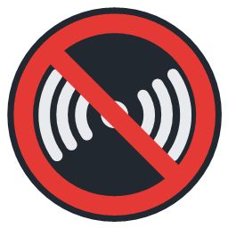
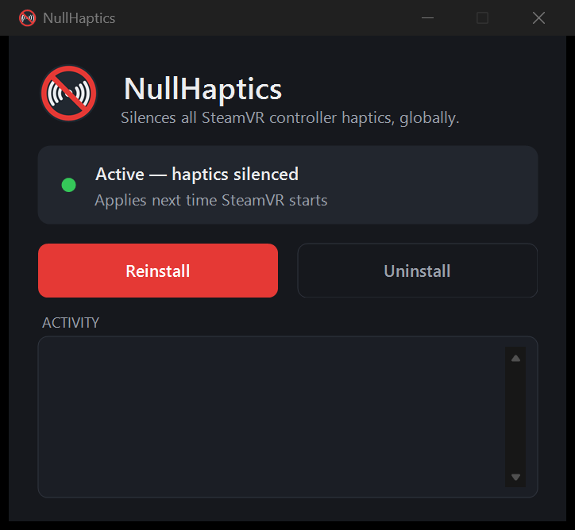

# NullHaptics

**A quality-of-life plugin that turns off *all* SteamVR controller vibration — once, for every game.**

[](https://github.com/KanaiCasual/NullHaptics/releases)
[](https://github.com/KanaiCasual/NullHaptics/releases/latest)
[](LICENSE)

<br clear="left">

Ever got annoyed by the constant buzzing — and then had to dig through the settings
of *every single game* to switch it off, one by one? Some games bury the option,
some don't have one at all, and the rumble drains your controller batteries the
whole time.

**NullHaptics fixes that in one click.** Install it once and controller haptics go
quiet across your entire library — every game and overlay, OpenVR and OpenXR alike —
with no per-game fiddling ever again. Changed your mind? Click **Uninstall** and
the buzz is back. That's the whole plugin.

<p align="center">
  
</p>

### Why you might want this

- 🔇 **Silence everywhere, instantly** — one install covers your whole SteamVR library.
- 🔋 **Save controller battery** — no motors spinning means longer play sessions.
- 🧩 **No per-game setup** — works even in games that hide or lack a rumble toggle.
- ♿ **Comfort & accessibility** — great if vibration is distracting, uncomfortable, or a sensory issue.
- ↩️ **Fully reversible** — toggle it off any time from the app or SteamVR's add-on list.

### How it works (the short version)

It's a tiny SteamVR add-on driver that catches every vibration request the moment
before it reaches your controllers and turns its strength down to zero. No files in
your games are touched, nothing is modified permanently — SteamVR just stops being
told to buzz. Curious about the details? It's ~90 lines in
[`src/driver.cpp`](src/driver.cpp), explained further [below](#how-it-works).

## Requirements

- Windows 10 (1903+) or Windows 11, 64-bit
- SteamVR installed
- Any SteamVR-supported controllers (developed and tested with Valve Index
  "knuckles"; the mechanism is controller-agnostic)

## Install

1. Download **`NullHaptics-setup.exe`** from the
   [latest release](../../releases/latest).
2. Run it and click **Install**.
3. **Restart SteamVR** (fully quit `vrserver`, not just exit VR) so it loads the
   driver.

That's it — haptics are now silenced everywhere. The installer is a single
self-contained exe; the driver files are embedded inside it and extracted to
`%LOCALAPPDATA%\NullHaptics`.

> **SmartScreen / antivirus note:** the exe is unsigned, so Windows SmartScreen
> may show "Windows protected your PC" (click *More info → Run anyway*), and
> because the driver uses inline hooking some antivirus tools may flag it
> heuristically. The full source is in this repo — build it yourself if you
> prefer (see [Building](#building-from-source)).

## Turning it off

Any of these re-enables normal haptics:

- Open the app and click **Uninstall**, or
- SteamVR → **Settings → Startup / Shutdown → Manage Add-ons** → toggle
  **NullHaptics** off, or
- Run `NullHaptics-setup.exe uninstall` from a terminal.

Restart SteamVR afterward for the change to take effect.

## How it works

All SteamVR drivers share one `vrserver.exe` process. When a game requests a
rumble, the runtime queues a `VREvent_Input_HapticVibration` event, and the
controller's own driver (e.g. `driver_lighthouse`) pulls it off the queue via
`IVRServerDriverHost::PollNextEvent` before driving the physical actuator.

NullHaptics is a device-less driver whose only job is to inline-hook that one
`PollNextEvent` function (using [MinHook](https://github.com/TsudaKageyu/minhook)).
Its hook lets each event through unchanged **except** haptic events, whose
`fAmplitude`, `fDurationSeconds`, and `fFrequency` fields it rewrites to zero in
place. The owning driver then runs the actuator at zero strength — silence — for
every source of haptics at once.

The whole mechanism is ~90 lines: see [`src/driver.cpp`](src/driver.cpp).

## Command-line usage

The installer doubles as a silent CLI for scripting:

```bat
NullHaptics-setup.exe install     :: extract + register the driver
NullHaptics-setup.exe uninstall   :: unregister + remove the driver
NullHaptics-setup.exe status      :: show a summary dialog
```

`install`/`uninstall` run without a window and return exit code 0 on success.
Running the exe with no arguments opens the GUI.

## Building from source

**Prerequisites:** Visual Studio 2022 with the *Desktop development with C++*
workload (which bundles CMake). No other dependencies — MinHook and the OpenVR
driver header are vendored under `third_party/`.

```powershell
.\build.ps1
```

This produces `dist\NullHaptics-setup.exe`. The build compiles the driver DLL,
embeds it (with the manifest, default settings, icon, and logo) as resources in
the installer, and stages the finished exe in `dist\`.

Prefer raw CMake? The equivalent is:

```powershell
cmake -S . -B build -G "Visual Studio 17 2022" -A x64
cmake --build build --config Release
```

### Regenerating the icon

The app icon and logo are generated programmatically (no binary art to maintain):

```powershell
powershell -ExecutionPolicy Bypass -File tools\make_icon.ps1
```

This rewrites `assets\app.ico` and `assets\logo-256.png`. Edit the colors and
geometry at the top of the script to restyle.

## Project layout

```
src/driver.cpp        The SteamVR add-on driver (the actual haptic-silencing hook)
src/setup.cpp         The self-contained installer GUI + CLI
package/              driver.vrdrivermanifest, default.vrsettings, app.manifest
assets/               app.ico, logo-256.png (generated by tools/make_icon.ps1)
tools/make_icon.ps1   Icon/logo generator
third_party/          Vendored MinHook + openvr_driver.h
CMakeLists.txt        Builds the driver, embeds it, links the installer
build.ps1             One-command build wrapper
```

## Third-party components & trademarks

See [THIRD_PARTY_NOTICES.md](THIRD_PARTY_NOTICES.md). NullHaptics is not
affiliated with or endorsed by Valve Corporation; "SteamVR", "Steam", "Valve",
and "Index" are trademarks of Valve Corporation.

## License

[MIT](LICENSE) — use it, modify it, repackage it. No warranty; use at your own
risk.
